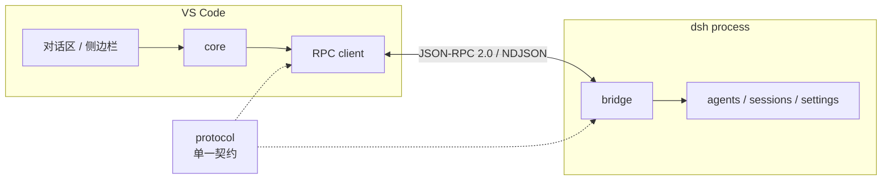

# Conduit · DSH to VS Code

**A conduit between dsh and the editor.** A transport bridge inside dsh plus an
editor client, connected by JSON-RPC 2.0 over a local process channel — no
ports, no tunnels, no browser.

[](LICENSE)
[](docs/protocol.md)
[](https://code.visualstudio.com/)

`dsh web` 把 harness 渲染成网页，本项目的方向相反：把 harness 的能力交给编辑器。
扩展以 `extensionKind: workspace` 运行，在 Remote-SSH 场景下直接跑在远端，
文件读写、终端与 diff 都在真实工作区完成。

## 架构



| 包 | 说明 |
| --- | --- |
| [`protocol/`](protocol/) | 方法表、DTO、事件、错误码。两侧编译时内联，运行期无依赖 |
| [`bridge/`](bridge/) | cordis 插件，挂载在 `rpc` profile，把 harness 能力暴露为 RPC 服务 |
| [`extension/`](extension/) | VS Code 扩展：连接、侧边栏、对话区、变更基线 |

## 能力

| 领域 | 能力 |
| --- | --- |
| 会话 | 创建、重命名、归档、删除、历史分页、取消当前轮次 |
| 模型 | 供应商管理、密钥托管、默认模型、会话内模型与思考强度切换 |
| 多 agent | 子 agent 树、状态、耗时、工具计数、按 agent 分组渲染 |
| 文件 | 工作区列举/读取（越界校验）、`@` 提及随消息投递 |
| 变更 | 以“上次确认”为基线的 diff，逐文件查看、还原、推进基线 |
| 插件 | 列出、搜索、安装、启停、卸载 dsh bundle |

## 安装

前置条件：Node.js 22.11+，已安装 dsh。

```bash
npm install -g @deepseek-ai/dsh

git clone https://github.com/conduit4dsh2vscode/conduit4dsh2vscode.git
cd conduit4dsh2vscode
npm install
npm run build

# 网关装进 rpc profile
dsh plugin --profile rpc add "$(pwd)/bridge"

# 扩展
cd extension && npm run package
code --install-extension conduit4dsh2vscode-0.8.0.vsix
```

打开一个文件夹，点击状态栏的 **DSH**，或在命令面板执行 `DSH: Connect`。

远端（Remote-SSH）场景下，扩展必须装在**远端**扩展宿主：

```bash
scp extension/conduit4dsh2vscode-0.8.0.vsix user@host:/tmp/
ssh user@host 'code-server --install-extension /tmp/conduit4dsh2vscode-0.8.0.vsix'
```

或使用脚本：`bash deploy/setup.sh --remote user@host`。

## 配置

```jsonc
{
  "dsh.transport": "stdio",
  "dsh.profile": "rpc",
  "dsh.permissionMode": "workspace-write",
  "dsh.providerConfig": {
    "providers": [
      {
        "id": "my-gateway",
        "kind": "openai",
        "baseURL": "https://api.example.com/v1",
        "apiKeyEnv": "MY_GATEWAY_KEY",
        "models": ["model-a", "model-b"]
      }
    ],
    "defaultModel": "model-a"
  }
}
```

密钥通过 `apiKeyEnv` 引用环境变量，由 dsh 的 credentials 服务解析，不写入
`settings.json`。也可以在命令面板执行 `DSH: Add Provider` 用单页面板配置。

完整设置见 [docs/extension.md](docs/extension.md)。

## 开发

```bash
npm run typecheck    # 三个 workspace
npm test             # 对话区单元测试
npm run docs         # 生成 docs/*.html（需联网查看图表）
```

- 对话区构建为单文件 IIFE，产物内联进 Webview；
- 网关用 esbuild 打包，harness 包保持 external；
- 扩展宿主用 esbuild 打成单文件 CJS，vsix 不携带 `node_modules`。

细节见 [docs/development.md](docs/development.md)。

## 文档

| 文档 | 内容 |
| --- | --- |
| [docs/index.md](docs/index.md) | 概述与快速开始 |
| [docs/architecture.md](docs/architecture.md) | 分层、依赖规则、事件模型 |
| [docs/protocol.md](docs/protocol.md) | RPC 方法表、通知、错误码、鉴权 |
| [docs/bridge.md](docs/bridge.md) | profile 挂载、harness 适配、凭据与路由 |
| [docs/extension.md](docs/extension.md) | 连接状态机、Webview 契约、变更基线 |
| [docs/development.md](docs/development.md) | 构建、测试、部署、排障 |

HTML 版本（Mermaid 图表 + 代码高亮，走 CDN）在 [`docs/*.html`](docs/index.html)。

## 设计约束

- **契约唯一**：所有方法、参数与事件都在 `protocol` 定义，缺实现会编译失败；
- **依赖单向**：`rpc → core → adapter → store`，业务层不引用 `vscode` 或 `rpc`；
- **降级而非失败**：能力协商按 `capabilities`，缺失时隐藏对应 UI；
- **状态有归属**：会话内容归 dsh，编辑器概念归 bridge，基线归工作区。

## 许可

[MIT](LICENSE)
