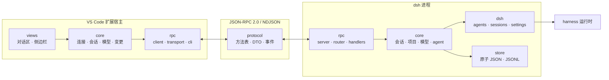
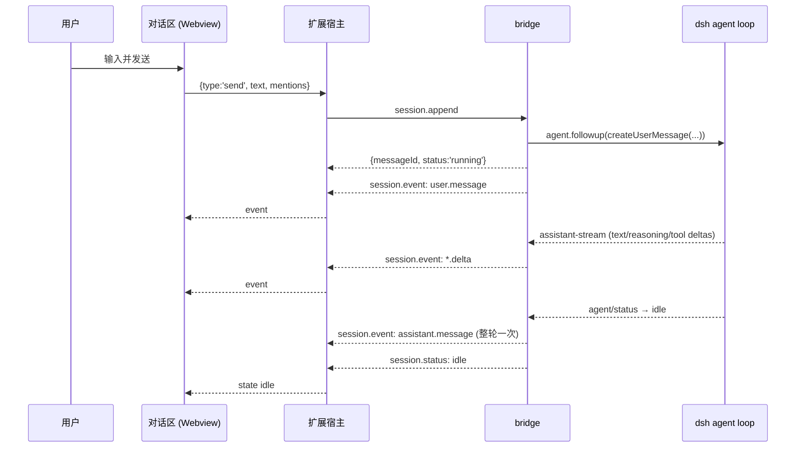

# 架构

## 目标

在编辑器里使用 DeepSeek Harness，同时满足三条约束：

1. 不引入网络端口：本地与远程使用同一条进程内通道；
2. 不复制业务逻辑：会话、模型、权限都由 dsh 负责；
3. dsh 的预发布 API 可以变化，但上层界面与协议保持稳定。

## 分层

依赖规则：

| 层 | 可以依赖 | 禁止依赖 |
| --- | --- | --- |
| `protocol` | 无 | 任何运行时包 |
| `bridge/rpc` | `core`、`protocol` | `dsh`（直接） |
| `bridge/core` | `dsh`、`store`、`protocol` | `rpc` |
| `bridge/dsh` | harness 包 | `rpc`、`core` |
| `extension/commands` | `core`、`views` | `rpc` 细节 |
| `extension/core` | `rpc`、`protocol` | `vscode` 以外的 UI |

`extension/views` 是唯一允许同时接触 UI 与领域服务的地方；`bridge/rpc/handlers`
只做参数校验与调用编排，不含业务分支。

## 一次对话的链路

关键点：

- `session.append` **不等待**模型完成，否则 stdio 通道会被长请求占满；
- `finish` 是 step 级终态，一轮可能包含多个 step，完整消息在 agent 回到
  idle 时发送一次；
- 子 agent 的事件带 `agent.id`，主 agent 的事件不带或为 `root`，界面据此分组。

## 两种会话后端

`SessionBackend` 是端口，`LiveBackend` 与 `ReplayBackend` 是两个实现。

| 方面 | live | replay |
| --- | --- | --- |
| 消息来源 | harness agent loop | 本地 JSONL |
| 事件 | 真实增量 | 固定回执 |
| 会话内容 | dsh 会话日志（`sessionQuery`，缺失时读磁盘） | `bridge-messages/` |
| 适用场景 | 正常使用 | 未配置模型、协议联调、离线演示 |

网关在装配时尝试 live，失败则自动回退 replay，`system.info.mode` 会告知客户端。
回放模式下对话区显示横幅，避免把本地回执误认为模型输出。

## 事件模型

事件由 `SessionEventHub` 统一出口：

1. 分配 `seq` 与 `ts`；
2. 若事件带 agent 引用，更新 `AgentRegistry`（状态、耗时、工具与消息计数）；
3. 扇出给传输层，由 `RpcServer` 转为 `session.event` / `agent.event` 通知。

这样做的好处是后端只需描述“发生了什么”，不需要关心订阅者、会话过滤或
序列化。agent 树的唯一事实来源也集中在一处。

## 状态归属

| 状态 | 存放位置 | 理由 |
| --- | --- | --- |
| 会话内容 | dsh 会话日志 | 与 `dsh web` 共享，重启不丢 |
| 项目、标题、归档标记 | `$DSH_HOME/bridge-*.json` | 编辑器概念，dsh 不建模 |
| provider 目录 | `bridge-providers.json` | 需要独立于 profile 的稳定视图 |
| 密钥 | dsh credentials 服务 | 不进入设置文件，按引用解析 |
| 变更基线 | 扩展 `workspaceState` + git 悬空提交 | 与工作区绑定，不跨机器同步 |

## 可靠性与安全

- **stdin 关闭即退出**：stdio 模式下进程生命周期由客户端掌握，不留孤儿；
- **心跳**：30 秒 `system.ping`，失败触发指数退避重连（最多 5 次）；
- **帧上限**：单行 16 MiB，超限直接拒绝，避免内存被单条消息拖垮；
- **tcp/unix 鉴权**：首条请求必须是 `auth`，token 用恒定时间比较；
- **路径越界**：`realpath` 后判断是否位于已注册工作区内，符号链接无法逃逸；
- **配置写入串行化**：启动同步与 RPC 写入共用一把 profile 锁，避免互相等待超时。

## 演进约束

`protocol` 是唯一契约。新增能力时：

1. 在 `MethodMap` 增加方法（未实现会导致编译失败）；
2. 在 `CAPABILITIES` 增加能力名；
3. 更新 `docs/protocol.md`；
4. 客户端按 `capabilities` 降级，不按版本号猜测。
