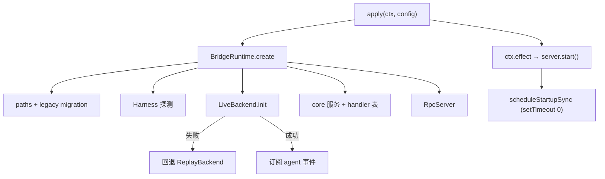

# 网关（bridge）

`@conduit4dsh2vscode/bridge` 是挂载在 dsh 进程内的 cordis 插件。它不渲染界面，
只把 harness 能力转换为 JSON-RPC 服务。

## 插件形态

```yaml
# cordis.patch.yml
- insert:
    - id: dsh-bridge
      name: '@conduit4dsh2vscode/bridge'
      config:
        transport: stdio
```

四导出约定：`name`、`inject`、`Config`、`apply`。

- `inject: ['sessions']`：没有会话服务时插件不应挂载；
- `Config` 由 schemastery 定义，`transport` 支持 `stdio` / `tcp` / `unix`；
- `apply` 只做两件事：构造 `BridgeRuntime`，用 `ctx.effect` 绑定启停。

安装：

```bash
dsh plugin --profile rpc add /absolute/path/to/bridge
```

profile 会把插件链接到 `$DSH_HOME/profiles/rpc`，因此**源码更新后无需重新注册**，
覆盖 `lib/` 即可（`node_modules` 保留）。

## 装配顺序



启动同步必须延后到 `apply` 返回之后：它会写 dsh 配置，而配置重载会等待所有
插件 fiber 激活，包括当前这个 fiber。提前同步会自我等待并卡死首次请求。
占位则在启动时立即建立，RPC 写入会排队等待它完成，避免两者争同一把 profile 写锁。

## dsh 适配层

`src/dsh/` 是唯一直接接触 harness 的目录。对外只暴露结构化类型，因此
harness 升级时改动局限在这一层。

| 文件 | 职责 |
| --- | --- |
| `context.ts` | 服务探测（agents / sessions / sessionQuery / credentials / settings / pluginManager），缺失即降级 |
| `agents.ts`（由 `runtime/live-backend.ts` 消费） | create / resume / followup / cancel，注入模型选择 |
| `session-log.ts` | 直读 `$DSH_HOME/sessions/*/<id>/session.v*.jsonl[.zstd]` |
| `messages.ts` | `createUserMessage` 解析、surface 事件重建消息、429 文案 |
| `plugins.ts` | pluginManager 门面与 registry 搜索 |
| `module-loader.ts` | 从 CLI 入口反推 dsh 包位置 |

### 会话内容为什么有两个来源

`ctx.sessionQuery.readSession()` 是首选。但它在部分 profile 装配下不可用
（`rpc-live.log` 会记录 `sessionQuery=false`），只依赖它会导致重开面板后历史为空。
因此读取失败或为空时，直接解析会话日志。日志是多帧 zstd：

- 每次 append 是一帧，`zstdDecompressSync` 只解第一帧；
- 崩溃可能留下截断帧，逐帧解压并跳过坏帧；
- 首行 `{"type":"session"}` 是文件头，需要剔除。

## 模型与凭据

### provider 目录

存储在 `$DSH_HOME/bridge-providers.json`。`model.providers.add` 与
`model.providers.sync` 都会把目录写入 harness 的 `llm-pi-ai` settings：

```json
{
  "providers": {
    "my-gateway": {
      "displayName": "my-gateway",
      "baseURL": "https://api.example.com/v1",
      "api": "openai-completions",
      "apiKeyEnv": "DSH_RPC_KEY_MY_GATEWAY",
      "retryPolicy": { "maxRetries": 6, "backoff": { "initialDelayMs": 2000, "maxDelayMs": 60000 } },
      "models": [{ "id": "model-a", "name": "model-a" }]
    }
  }
}
```

`api` 由 kind 推导：包含 `anthropic` / `claude` 时为 `anthropic-messages`，
否则为 `openai-completions`。

### 密钥

密钥写入 dsh 的 credentials 服务，ref 为 `DSH_RPC_KEY_<PROVIDER_ID>`（非法字符
折叠为 `_` 并大写）。settings 中只保存引用名。

凭据服务不可用时的降级顺序：

1. 写入进程环境变量（当前进程有效）；
2. 启动时把旧版 `ref = providerId` 的密钥迁移到新命名；
3. 若环境变量由启动环境只读导出，视为已生效。

### 重试策略

每个路由都写入 `retryPolicy`：6 次、2s 起、上限 60s、25% 抖动。默认策略对
配额型 429 太短，而且 `Retry-After` 超过上限时会直接放弃重试。

## 持久化

| 文件 | 内容 |
| --- | --- |
| `bridge-projects.json` | 项目注册表 |
| `bridge-sessions.json` | 会话元数据（projectId / title / archived） |
| `bridge-messages/<id>.jsonl` | replay 后端的消息 |
| `bridge-providers.json` | provider 目录 |
| `bridge-default-model.json` | 全局默认模型与思考强度 |
| `bridge-config.json` | `config.set` 的自由配置 |
| `bridge-agents/<id>.json` | agent 登记表 |
| `bridge.log` | 诊断日志（上限 2 MiB） |

写入采用临时文件 + rename；Windows 上 rename 失败时回退为原地写。
首次启动会把旧版的 `rpc-*.json` 迁移到新文件名，避免升级丢状态。

## 事件到协议的映射

| harness 事件 | 协议事件 |
| --- | --- |
| `agent/assistant-stream` + `text-delta` | `text.delta` |
| `agent/assistant-stream` + `reasoning-delta` | `reasoning.delta` |
| `agent/assistant-stream` + `tool-call-delta` | `tool.call`（参数跨片累积） |
| `agent/assistant-stream` + `finish` | 仅清理参数缓冲，不发事件 |
| `agent/status` → idle/completed | `assistant.message`（整轮文本）+ `agent.status` |
| `agent/created` | `agent.spawn`（成功状态映射为 pending） |
| `agent/disposed` | `agent.result` |
| `agent/error` / `agent/request-error` | `error` |

用户主动取消后，harness 会把状态置回 idle，不会单独报 cancelled。网关记录取消
意图，在终止事件到达时改写为 `cancelled`，避免界面误报“已完成”。

## 权限与审批

网关适配两个 harness 服务：

| harness 服务 | 网关中的职责 |
| --- | --- |
| `permissionPresets` | 读取预设目录、按会话读写当前预设（`permission.*`） |
| `approval` + `approval/request` | 注册唯一的审批回答者，把问题转发给编辑器 |

预设把沙箱模式与审批策略打包，`permission.set` 直接调用
`permissionPresets.set(session, name)`，由 harness 自己写入两个 knob，
因此切换对**当前会话立即生效**，不重启进程、不新建 agent。若会话只存在
元数据里（从未 resume），网关先 `ensureLive()` 再应用，否则没有可寻址对象。

审批是关键路径：`approval/request` 是 cordis 瀑布，谁先返回谁说了算，没有
回答者就会 `unavailable`（失败关闭）。网关在激活期只做订阅、不写任何 dsh
配置，把问题挂起到 `approval.respond`，并有三道兜底：

1. 5 分钟超时 → `cancelled`，工具动作不执行；
2. 请求被撤销（turn 结束）→ 监听 `AbortSignal`，同样 `cancelled`；
3. 没有客户端连接 → 直接 `unavailable`。

`allowed-once` 只对本次调用有效，不做任何记忆。

## 终止链路

`session.cancel` 依次做四件事：

1. 取消该会话登记的全部子 agent（它们跑在自己的 session 里）；
2. 取消根 agent；
3. 把仍在进行中的工具调用补成 `cancelled` 结果——harness 不会为被中断的
   调用补发 `tool/result`，不补就会永远停在 running；
4. 冲刷本轮流式文本，然后置 `idle`。

`agent.cancel(agentId≠root)` 只停那一个子 agent。句柄来自 `agent/created`
与流事件中出现的子 agent，因此只能取消**本进程内见过**的 agent；未知 id
返回 `-32602` 而不是静默成功。

## 限制

- `session.fork` 仅在 replay 后端可用；
- live 模式下子 agent 的归属依赖“当前运行中的主会话”，并行运行多个会话时
  子 agent 可能挂到最先运行的那个；
- 插件搜索走 registry HTTP 接口，企业内网需要可访问 registry。
