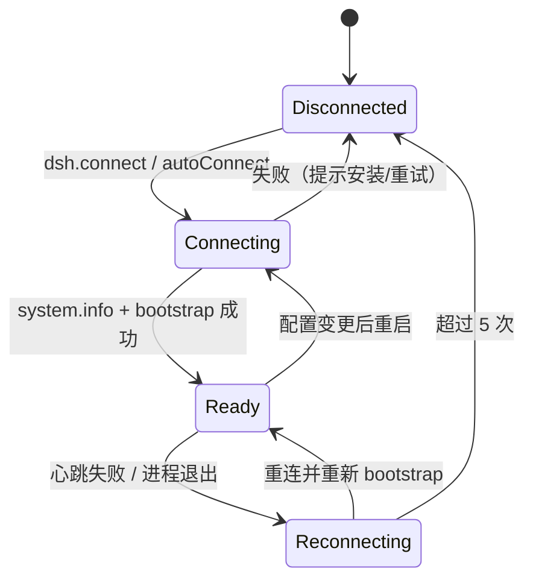

# 编辑器客户端（extension）

本扩展是一个 `extensionKind: workspace` 的扩展。它不做模型调用，
只负责连接网关、组织视图、维护编辑器侧状态（变更基线、界面偏好）。

## 目录

```
src/
├── extension.ts          组合根：激活、状态栏、通知、配置监听
├── rpc/                  客户端、传输、CLI 探测
├── core/                 连接、会话、模型、agent、插件、变更
├── commands/             命令注册（按领域拆分）
├── views/
│   ├── host/             面板宿主：HTML、对话区、供应商面板
│   ├── trees/            五个侧边栏视图
│   ├── theme/            调色板与偏好
│   └── chat/             Vue 对话区（独立 tsconfig）
└── util/
```

`views` 允许依赖 `core`，`core` 不依赖 `vscode` 以外的视图代码；`rpc` 只被
`core` 使用。命令层是唯一同时接触服务与视图的地方。

## 激活流程



bootstrap 做三件事：

1. `project.ensure`：以工作区路径登记项目；
2. 恢复上次会话（`globalState` 按项目记录），不存在则创建；
3. 写入 context key `dsh.connected` / `dsh.multiAgent` / `dsh.pluginManagement`，
   视图与菜单据此显隐。

## 传输与 CLI 探测

- `stdio`：spawn `dsh --profile <profile>`，把 `DSH_PERMISSION_MODE` 与
  `DSH_RPC_LIVE` 注入环境；
- `tcp` / `unix`：连接后在首条请求前发送 `auth`；
- CLI 解析顺序：`dsh.cliPath` → `dsh`（PATH）→ `npx --yes @deepseek-ai/dsh`。

客户端把 stderr 视为诊断输出，不参与协议解析；stdout 中非 JSON 行会被记录并跳过，
避免 harness 横幅污染导致整个通道失效。

## 对话区契约

Webview 与宿主之间只有消息，没有共享模块状态。

### 页面 → 宿主

| type | 载荷 | 说明 |
| --- | --- | --- |
| `ready` | — | 请求快照 |
| `send` | `{text, mentions?}` | 发送消息 |
| `history` | — | 请求更早一页 |
| `setModel` | `{modelId, effort?}` | 会话内切换 |
| `stop` | — | 取消当前轮次 |
| `listFiles` | — | `@` 提及的数据源 |
| `copy` | `{text}` | 由宿主写剪贴板 |
| `confirmChanges` / `compareCode` | — | 转交命令 |
| `newEntry` | — | 新建会话 |
| `collapseAll` / `expandAll` | `{collapsed}` | 折叠控制 |
| `openUiSettings` | — | 打开设置 |

### 宿主 → 页面

| type | 载荷 | 说明 |
| --- | --- | --- |
| `snapshot` | 会话 + 最近一页消息 + providers + agents | 首屏 |
| `historyPage` | `{messages, hasMore, total, error?}` | 向前一页 |
| `event` | `SessionEvent` | 增量事件 |
| `state` | `{status}` | running / idle |
| `agent` | `AgentInfo` | agent 变化 |
| `providers` | `{providers, defaultModelId?}` | 供应商热更新 |
| `changes` | `{total, confirmedAt}` | 待确认数量 |
| `theme` | `{palette}` | CSS 变量 |
| `prefs` | `{prefs}` | 折叠与排版 |
| `serverMode` | `{mode}` | 回放横幅 |
| `fileList` | `{files, truncated?, error?}` | 提及候选 |

### 卡片模型

页面把消息、思考、工具调用、系统提示统一为 `ChatCard`：

```ts
{
  key: string        // 客户端定位流式卡
  kind: 'user' | 'assistant' | 'reasoning' | 'tool' | 'system' | 'error'
  text: string
  collapsed: boolean
  streaming: boolean
  turn: number       // 每条 user.message 递增
  agentId: string    // '' / 'root' 为主列表
  tool?: ToolCall
}
```

流式定位 = 在数组里找「同容器 + 同轮次 + 同类型 + streaming」的卡，不再查询 DOM。
完整消息到达时优先回填该卡，其次按轮次合并，绝不新建第二张。

### 历史分页

- 首屏只下发最近 20 条；
- 上滑到距顶部 80px 触发 `history`，宿主用最早消息 id 作为游标；
- 插入更早一页时，页面记录插入前的 `scrollHeight`，插入后把 `scrollTop`
  平移同样的差值，视口内容不动；
- 内容不足一屏时主动补页，直到可滚动或没有更早消息；
- 请求 10 秒未响应则解锁并提示可重试。

### 安全

- CSP 使用 `webview.cspSource`，**不能写 `'self'`**：Remote-SSH 下资源经
  CDN 代理，`'self'` 会静默拦掉样式；
- 构建产物**内联**进 HTML（`<script nonce>` / `<style>`），不通过
  `asWebviewUri` 外部引用：远端场景下外部资源实测加载失败；
- 内联前转义内容中的 `</script>` / `</style>`，防止提前闭合文档；
- 页面注入 `window.__dshFatal`，运行期异常直接显示在面板上，便于远端排障。

## 变更跟踪

基线有两种模式，自动选择：

| 条件 | 模式 | 基线 |
| --- | --- | --- |
| 工作区在 git 仓库内且有 HEAD | git | `git stash create -u` 生成的悬空提交，挂到 `refs/dsh/baseline-*` |
| 其他情况 | snapshot | 文件元数据 + 文本副本（`globalStorage/dsh-snapshots`） |

- 改动 = 基线 → 当前工作区，覆盖已跟踪、未提交与未跟踪文件；
- 「确认变更」把基线推进到当前状态，可选顺手创建 git 检查点；
- 白名单（`dsh.changes.whitelist`）在遍历、基线清单与 git diff 三处同时过滤；
- 快照模式保留最近 3 份，单文件副本上限 512 KiB、总量 2000 份。

## 调色板

Webview 无法解析 VS Code 主题 token，因此宿主把颜色解析成 `--dsh-*` 变量下发：

| 变量 | 用途 |
| --- | --- |
| `--dsh-accent` | 主按钮、活动态 |
| `--dsh-user-bubble` / `--dsh-assistant-bubble` | 气泡底色 |
| `--dsh-border` / `--dsh-system-text` | 分隔线与次要文字 |
| `--dsh-selection-text` / `--dsh-selection-bg` | 选区 |
| `--dsh-agent-*` / `--dsh-tool-*` | 状态色 |

`dsh.ui.*` 为空时跟随明暗主题；高对比主题使用 `currentColor` 兜底。

## 配置

| 键 | 默认 | 作用 |
| --- | --- | --- |
| `dsh.cliPath` | `""` | CLI 路径 |
| `dsh.home` | `""` | `DSH_HOME` |
| `dsh.profile` | `rpc` | profile |
| `dsh.transport` | `stdio` | 传输方式 |
| `dsh.rpcHost` / `dsh.rpcPort` / `dsh.rpcSocketPath` / `dsh.rpcToken` | — | tcp/unix 参数 |
| `dsh.permissionMode` | `workspace-write` | 初始沙箱级别（经 `DSH_PERMISSION_MODE` 传入）；会话内切换用 `DSH: Set Permission` |
| `dsh.enableLiveAgentLoop` | `true` | 真实 agent loop |
| `dsh.autoConnect` | `true` | 打开工作区后自动连接 |
| `dsh.autoOpenChat` | `false` | 连接后打开对话区 |
| `dsh.providerConfig` | `{}` | 声明式供应商配置 |
| `dsh.changes.*` | 见设置页 | 变更跟踪 |
| `dsh.ui.*` | 见设置页 | 外观与折叠 |

配置变化的分流：

- `dsh.providerConfig` → 同步供应商，不重启连接；
- `dsh.ui` → 只重发调色板与偏好；
- `dsh.changes` → 重算基线 diff；
- 其余 `dsh.*` → 重启客户端并重新 bootstrap。

## 命令

| 分组 | 命令 |
| --- | --- |
| 连接 | `dsh.connect`、`dsh.installCli` |
| 会话 | 新建、打开、重命名、分叉、归档、取消归档、复制 ID、删除、刷新 |
| 模型 | 添加供应商、设置密钥、删除供应商、设为默认、同步配置、刷新 |
| Agent | 刷新、详情、取消 |
| 权限 | `dsh.setPermission`、`dsh.showPermission` |
| 变更 | 确认、对比、刷新、重置基线、加入白名单、打开 diff、还原 |
| 插件 | 刷新、搜索安装、输入 spec 安装、启停、卸载 |
| 界面 | 全部折叠、全部展开、外观设置 |

## 权限与终止

权限有两条入口，指向同一份会话状态：

- 对话页标题栏的预设下拉（模型选择旁边）与状态栏的盾牌图标；
- 命令面板的 `DSH: Set Permission` / `DSH: Show Permission Details`。

预设由 harness 的 `dsh-permission-presets` 定义，同时决定沙箱模式与审批策略：
`read-only`/`workspace-write` 配 `ask`，`danger-full-access` 配 `never`。
切换即时生效，不改写 `dsh.permissionMode`（那个设置只决定新会话的起点）。
harness 未装配权限服务时，控件直接隐藏。

工具动作越出沙箱时，harness 走 `approval/request` 瀑布；网关把它转成编辑器
模态框（Allow once / Deny）。**只有一次授权**，不记忆；关闭弹窗即拒绝；5 分钟
无响应或没有客户端连接时按失败关闭处理，动作不会执行。

终止分三级：

| 操作 | 作用 |
| --- | --- |
| `Esc` / 输入框 Stop | 终止整轮：根 agent 与所有子 agent 一起停 |
| 子 agent 卡片上的 Stop | 只停该子 agent，整轮继续 |
| `DSH: Cancel Agent`（Agent 树） | 同上，带确认 |

被中断的工具调用会立即标为 `cancelled`（harness 不会为它们补发结果），
已产生的部分文本保留为只读内容。
